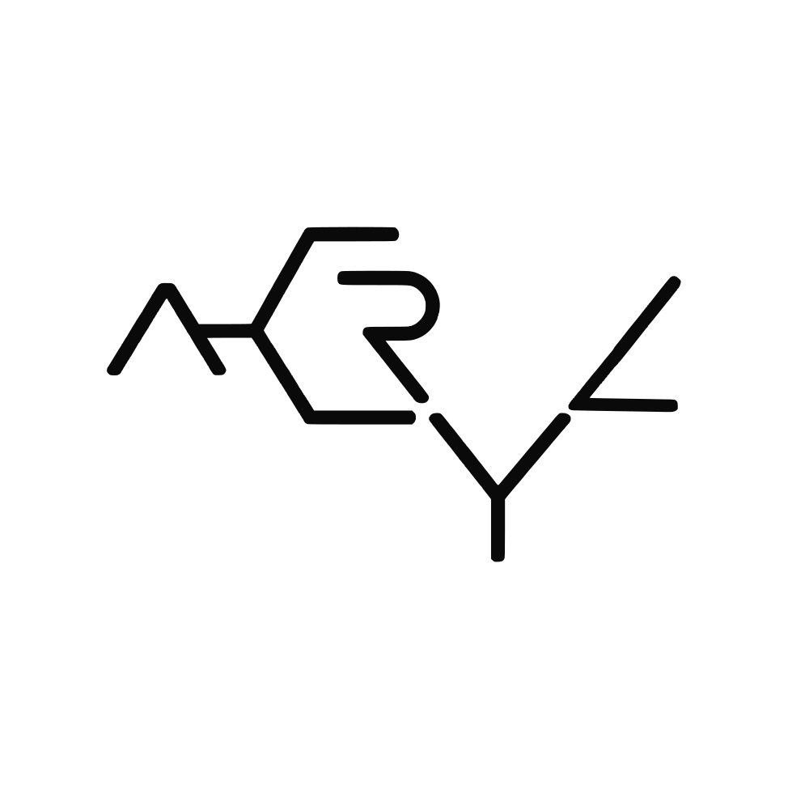

<p align="center">
  
</p>

<h1 align="center">ACRYL: everything is a plugin. Build agentic apps.</h1>

<p align="center">
  <strong>Let your users build the product they need.</strong><br>
  Every ACRYL app has its own agent. Your users say "add XYZ", and seconds later the change is live for them and their team.
  You keep shipping the foundation; they keep their layer.
</p>

<p align="center">
  <a href="https://acryl.dev/">Website</a> ·
  <a href="https://acryl.dev/start">Get started</a> ·
  <a href="https://acrylblends.github.io">Blends store</a> ·
  <a href="https://cordisplugins.github.io">Cordis Plugins</a> ·
  <a href="https://discord.gg/cY9KXMex69">Discord</a>
</p>

<p align="center">
  <a href="https://github.com/acryldev/acryl"></a>
  <a href="https://www.npmjs.com/package/acryl"></a>
  <a href="LICENSE"></a>
  <a href="https://discord.gg/cY9KXMex69"></a>
</p>

## Get started

Install ACRYL Control Center in one line. No Node and no admin for the app itself (if git or a desktop library is missing, Linux asks for sudo once), the download is checked against GitHub's sha256, and Windows and macOS open it without warnings because it is not browser-downloaded.

**macOS and Linux**
```sh
curl -fsSL https://acryl.dev/install.sh | bash
```

**Windows (PowerShell)**
```powershell
irm https://acryl.dev/install.ps1 | iex
```

**Developers:** `npx acryl@latest`

## What ACRYL is

Build agentic apps from plugins. Start blank, grow with an agent, share what you make. ACRYL is the open platform and framework underneath:
the agent is one part of your app, and our own IDE (ACRYL ADE) is one app built on it.

## Start in one command

You need Node.js 22.19 or newer, npm and git. Nothing to install first: `npx` fetches ACRYL when you run it.

| Command | What it opens |
| --- | --- |
| `npx acryl@latest` | ACRYL Control Center in your terminal: your apps, the Blends store, make, start, share, pull, deploy |
| `npx acryl@latest --gui` | ACRYL Control Center as a desktop app |
| `npx acryl@latest --web` | ACRYL Control Center in your browser |
| `npx acryl@latest new my-app` | A blank app with the agent inside it |
| `npx acryl@latest new my-app --from acrylblends.csv-explorer` | An app made from a Blend in the store, yours to change |

Always `@latest`: an old npm cache or a slow registry mirror can otherwise start an older ACRYL.

`npx acryl@latest --tui` is the same as `npx acryl@latest`. Prefer a download? ACRYL Control Center for macOS, Windows and Linux:
[Releases](https://github.com/acrylblends/63-acryl-control-center/releases/latest).

## How your users build: five steps

1. **Building blocks, not source code.** Every app is assembled from Cordis plugins: UI, data and actions behind stable services.
2. **The agent builds with those blocks.** ACRYL's chat, and Claude Code, Codex or Pi, operate the app through its door. The core code stays untouched.
3. **Sandboxed per person.** Every app runs in its own instance, on your machine or in your own [WebBox](https://webboxes.ai), with your rights only.
4. **Your change is a versioned layer: a Blend.** Save, roll back, share it to GitHub, list it in the store.
5. **The foundation keeps shipping.** `npx acrylblends@latest update` merges new releases under your layer, and your changes stay.

Stop selling features. Sell a platform your customers finish themselves.

## Five nouns: the whole model

| Noun | What it is |
| --- | --- |
| **App** | A folder: `blend.yaml`, its plugins, its data. Copy the folder, copy the app. |
| **Host** | One process per app. It loads plugins and swaps them while the app runs. |
| **Plugin** | The only unit of capability: a page, a tool, a service. |
| **Surface** | Web or Desktop. It draws what the Host serves and owns no logic. |
| **Driver** | An agent working inside the app. The built-in chat is one of many. |

## Share and pull

- **Blends (whole apps):** share your app to your own GitHub repository and list it in the store as Community (`npm run share -- --visibility public --list`).
  Anyone makes an app from it (`npx acryl@latest new their-app --from github:you/your-app#v0.1.0`) and later brings in your next release with
  `npx acrylblends@latest update`, keeping their own changes.
- **Cordis plugins (single capabilities):** publish a plugin to your GitHub (`npm run acryl -- plugin publish <name>`) and pull anyone's into your app
  by its address (`npm run acryl -- plugin pull github:owner/repo@version`).
- **WebBoxes:** deploy any Blend to your own hosted box at [webboxes.ai](https://webboxes.ai), with its agents.

Step-by-step guides: [Share a Blend](framework/docs/framework/guides/share-blends.md), [Share a plugin](framework/docs/framework/guides/share-plugins.md).

## What is in this repository

The reusable building blocks of the platform: the framework (`framework/`: `@acryldev/blends`, `@acryldev/create-blends`, the frame), the runtime
(`runtime/`), the plugins (`plugins/`) and the `acryl` command (`distribution/acryl-npm-launcher`). Products built on them live in their own
Blend repositories: [ACRYL Control Center](https://github.com/acrylblends/63-acryl-control-center), [ACRYL ADE](https://github.com/acrylblends/05-acryl-ade),
[ACRYL SDE](https://github.com/acrylblends/05-acryl-sde). Framework documentation: [`framework/docs`](framework/docs/README.md).

ACRYL builds on [Cordis](https://github.com/cordiverse/cordis), the meta-framework of composable plugins, and on a pinned
[DeepSeek Harness](https://github.com/deepseek-ai/deepseek-harness) checkout for its chat agent. ACRYL is not affiliated with, authorized by, or endorsed by DeepSeek.

## Run from source

Requirements: Node.js `^22.19.0` or `>=24.0.0`, Corepack (selects the pinned PNPM 12.14.0). Node 25 and later no longer include
Corepack (Arch Linux, Omarchy and mise install the newest Node): run `npm install -g corepack` once first.

```sh
corepack pnpm run upstream:sync
corepack pnpm install --frozen-lockfile
corepack pnpm run build
corepack pnpm run verify
```

Essentials:

- `corepack pnpm run verify` - fast headless loop (typecheck + tests)
- `corepack pnpm run check` - complete headless gate, use before handoff

Repository layout: `framework/` (the Blends framework and its packages), `runtime/` (the stable core), `plugins/` (replaceable capability packages), `distribution/` (the `acryl` command), `deepseek-harness/` (pinned upstream submodule, never edited from a feature branch). `scripts/verify-layout.mjs` enforces it.

## Project links

- Website: [acryl.dev](https://acryl.dev/) · Documentation: [acryl.dev/docs](https://acryl.dev/docs)
- ACRYL Blends: [acrylblends.github.io](https://acrylblends.github.io) · Cordis Plugins: [cordisplugins.github.io](https://cordisplugins.github.io)
- Discord: [discord.gg/cY9KXMex69](https://discord.gg/cY9KXMex69)
- Cordis: [github.com/cordiverse/cordis](https://github.com/cordiverse/cordis) · DeepSeek Harness: [github.com/deepseek-ai/deepseek-harness](https://github.com/deepseek-ai/deepseek-harness)

## Contributing

ACRYL welcomes contributors interested in agent interoperability, persistent context, Cordis plugins, developer tooling, terminals, editors, dynamic UI, security, and self-extensible software.

Before contributing, read [`AGENTS.md`](AGENTS.md), the [ACRYL orientation](docs/onboarding/orientation_spec_acryl.md), and the [Cordis specification](docs/cordis/cordis_spec.md). Join the [Discord](https://discord.gg/cY9KXMex69) to discuss the project.

## Contributors

Thanks to everyone building ACRYL - every report, idea, and PR counts:

<p>
  <a href="https://github.com/musichen" title="musichen"></a>
  <a href="https://github.com/levonk" title="levonk"></a>
  <a href="https://github.com/kuishou68" title="kuishou68"></a>
  <a href="https://github.com/smrifat1411" title="smrifat1411"></a>
</p>

[All contributors on GitHub](https://github.com/acryldev/acryl/graphs/contributors).

Who did what, by name: [CONTRIBUTORS.md](CONTRIBUTORS.md) ([中文](CONTRIBUTORS.zh.md)). Your name belongs here - see [CONTRIBUTING.md](CONTRIBUTING.md).

## License

ACRYL is licensed under the [MIT License](LICENSE).

## Acknowledgements

ACRYL builds on the work of the [Cordis](https://github.com/cordiverse/cordis) community and continues architectural inspiration from [DeepSeek Harness](https://github.com/deepseek-ai/deepseek-harness). We are grateful to both projects and to the broader open-source coding-agent ecosystem.
