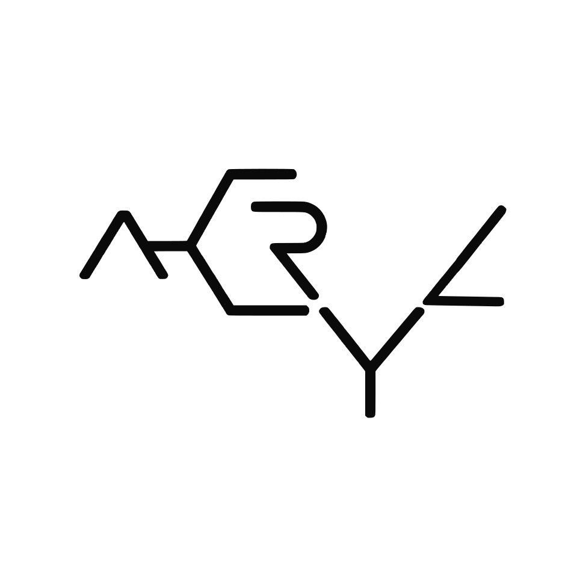

<p align="center">
  
</p>

<h1 align="center">ACRYL：一切皆插件，构建智能体应用。</h1>

<p align="center">
  <strong>让你的用户自己做出他们需要的产品。</strong><br>
  每个 ACRYL 应用都有自己的智能体。用户说"加上 XYZ"，几秒钟后，这个改动就对他们和他们的团队生效了。
  你继续交付底座，他们保留自己的那一层。
</p>

<p align="center">
  <a href="https://acryl.dev/">官网</a> ·
  <a href="https://acryl.dev/start">快速开始</a> ·
  <a href="https://acrylblends.github.io">Blends 商店</a> ·
  <a href="https://cordisplugins.github.io">Cordis 插件</a> ·
  <a href="https://discord.gg/cY9KXMex69">Discord</a>
</p>

<p align="center">
  <a href="https://github.com/acryldev/acryl"></a>
  <a href="https://www.npmjs.com/package/acryl"></a>
  <a href="LICENSE"></a>
  <a href="https://discord.gg/cY9KXMex69"></a>
</p>

> 本文是英文 [`README.md`](README.md) 的中文版，内容保持一致；两种语言同等有效。

## ACRYL 是什么

用插件构建智能体应用。从空白开始，和智能体一起成长，把做出来的东西分享出去。ACRYL 是底层的开放平台和框架：
智能体只是你应用的一部分，我们自己的 IDE（ACRYL ADE）也只是构建在它之上的一个应用。

## 一条命令开始

需要 Node.js 22.19 或更新版本、npm 和 git。不用先安装任何东西：运行时 `npx` 会自动获取 ACRYL。

| 命令 | 打开什么 |
| --- | --- |
| `npx acryl@latest` | 终端里的 ACRYL Control Center：你的应用、Blends 商店，以及创建、启动、分享、拉取、部署 |
| `npx acryl@latest --gui` | 桌面应用形式的 ACRYL Control Center |
| `npx acryl@latest --web` | 浏览器里的 ACRYL Control Center |
| `npx acryl@latest new my-app` | 一个内置智能体的空白应用 |
| `npx acryl@latest new my-app --from acrylblends.csv-explorer` | 用商店里的某个 Blend 创建的应用，可以随意修改 |

请始终带上 `@latest`：旧的 npm 缓存或较慢的镜像源，可能会启动旧版本的 ACRYL。

`npx acryl@latest --tui` 与 `npx acryl@latest` 相同。更想下载安装？macOS、Windows 和 Linux 版的 ACRYL Control Center 在
[Releases](https://github.com/acrylblends/63-acryl-control-center/releases/latest)。

## 你的用户如何构建：五步

1. **积木，而不是源码。** 每个应用都由 Cordis 插件组装而成：界面、数据和动作，都在稳定的服务之后。
2. **智能体用这些积木构建。** ACRYL 的聊天，以及 Claude Code、Codex 或 Pi，都通过应用的"门"来操作它。核心代码保持不动。
3. **按人沙箱化。** 每个应用在自己的实例里运行，在你的电脑上，或在你自己的 [WebBox](https://webboxes.ai) 里，只拥有你自己的权限。
4. **你的改动是一个带版本的层：一个 Blend。** 保存、回滚、分享到 GitHub、上架到商店。
5. **底座继续发布新版本。** `npx acrylblends@latest update` 把新版本合并到你的层之下，你的改动依然保留。

别再卖功能了。卖一个让客户自己完成的平台。

## 五个名词：完整的模型

| 名词 | 含义 |
| --- | --- |
| **App（应用）** | 一个文件夹：`blend.yaml`、它的插件、它的数据。复制文件夹，就复制了应用。 |
| **Host（宿主）** | 每个应用一个进程。它加载插件，并在应用运行时替换它们。 |
| **Plugin（插件）** | 能力的唯一单元：一个页面、一个工具、一项服务。 |
| **Surface（界面）** | Web 或桌面。它绘制宿主提供的内容，自己不含任何逻辑。 |
| **Driver（驱动）** | 在应用内部工作的智能体。内置聊天只是其中之一。 |

## 分享与拉取

- **Blends（整个应用）：** 把你的应用分享到你自己的 GitHub 仓库，并作为 Community 上架到商店（`npm run share -- --visibility public --list`）。
  任何人都可以用它创建应用（`npx acryl@latest new their-app --from github:you/your-app#v0.1.0`），之后用
  `npx acrylblends@latest update` 取得你的下一个版本，同时保留自己的改动。
- **Cordis 插件（单项能力）：** 把插件发布到你的 GitHub（`npm run acryl -- plugin publish <name>`），
  并通过地址把别人的插件拉进你的应用（`npm run acryl -- plugin pull github:owner/repo@version`）。
- **WebBoxes：** 把任何 Blend 部署到你自己在 [webboxes.ai](https://webboxes.ai) 的托管 box，连同它的智能体一起。

分步指南：[分享一个 Blend](framework/docs/framework/guides/share-blends.md)、[分享一个插件](framework/docs/framework/guides/share-plugins.md)。

## 本仓库包含什么

平台可复用的积木：框架（`framework/`：`@acryldev/blends`、`@acryldev/create-blends`、frame）、运行时
（`runtime/`）、插件（`plugins/`）和 `acryl` 命令（`distribution/acryl-npm-launcher`）。基于这些积木构建的产品放在各自的
Blend 仓库里：[ACRYL Control Center](https://github.com/acrylblends/63-acryl-control-center)、[ACRYL ADE](https://github.com/acrylblends/05-acryl-ade)、
[ACRYL SDE](https://github.com/acrylblends/05-acryl-sde)。框架文档：[`framework/docs`](framework/docs/README.md)。

ACRYL 构建在 [Cordis](https://github.com/cordiverse/cordis)（可组合插件的元框架）之上，聊天智能体使用固定版本的
[DeepSeek Harness](https://github.com/deepseek-ai/deepseek-harness)。ACRYL 与 DeepSeek 没有隶属关系，也未获其授权或认可。

## 从源码运行

要求：Node.js `^22.19.0` 或 `>=24.0.0`，Corepack（它会选择固定的 PNPM 12.14.0）。

```sh
corepack pnpm run upstream:sync
corepack pnpm install --frozen-lockfile
corepack pnpm run verify
```

常用命令：

- `corepack pnpm run verify` - 快速的无界面循环（类型检查 + 测试）
- `corepack pnpm run check` - 完整的无界面检查，交接前使用

仓库布局：`framework/`（Blends 框架及其包）、`runtime/`（稳定的核心）、`plugins/`（可替换的能力包）、`distribution/`（`acryl` 命令）、`deepseek-harness/`（固定版本的上游子模块，从不在功能分支上修改）。`scripts/verify-layout.mjs` 负责强制检查。

## 项目链接

- 官网：[acryl.dev](https://acryl.dev/) · 文档：[acryl.dev/docs](https://acryl.dev/docs)
- ACRYL Blends：[acrylblends.github.io](https://acrylblends.github.io) · Cordis 插件：[cordisplugins.github.io](https://cordisplugins.github.io)
- Discord：[discord.gg/cY9KXMex69](https://discord.gg/cY9KXMex69)
- Cordis：[github.com/cordiverse/cordis](https://github.com/cordiverse/cordis) · DeepSeek Harness：[github.com/deepseek-ai/deepseek-harness](https://github.com/deepseek-ai/deepseek-harness)

## 参与贡献

ACRYL 欢迎对这些方向感兴趣的贡献者：智能体互操作、持久化上下文、Cordis 插件、开发者工具、终端、编辑器、动态 UI、安全，以及可自我扩展的软件。

贡献之前，请阅读 [`AGENTS.md`](AGENTS.md)、[ACRYL 入门说明](docs/onboarding/orientation_spec_acryl.md)和 [Cordis 规范](docs/cordis/cordis_spec.md)。欢迎加入 [Discord](https://discord.gg/cY9KXMex69) 一起讨论。

## 贡献者

感谢每一位参与构建 ACRYL 的人，每一份报告、想法和 PR 都算数：

<p>
  <a href="https://github.com/musichen" title="musichen"></a>
  <a href="https://github.com/levonk" title="levonk"></a>
  <a href="https://github.com/kuishou68" title="kuishou68"></a>
  <a href="https://github.com/smrifat1411" title="smrifat1411"></a>
</p>

[GitHub 上的所有贡献者](https://github.com/acryldev/acryl/graphs/contributors)。

具体谁做了什么，按姓名记录在：[CONTRIBUTORS.md](CONTRIBUTORS.md)（[中文](CONTRIBUTORS.zh.md)）。你的名字也属于这里，见 [CONTRIBUTING.md](CONTRIBUTING.md)。

## 许可证

ACRYL 使用 [MIT 许可证](LICENSE)。

## 致谢

ACRYL 建立在 [Cordis](https://github.com/cordiverse/cordis) 社区的工作之上，并延续了来自 [DeepSeek Harness](https://github.com/deepseek-ai/deepseek-harness) 的架构灵感。感谢这两个项目，也感谢更广阔的开源编程智能体生态。
