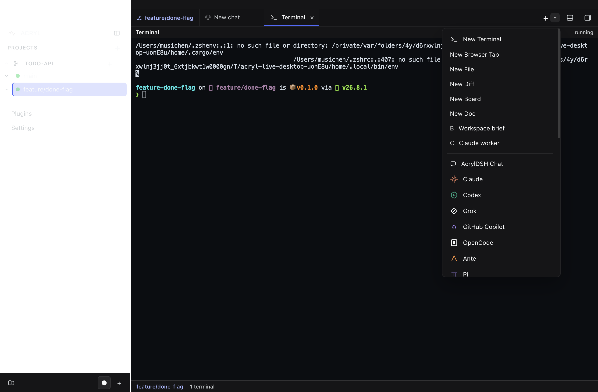
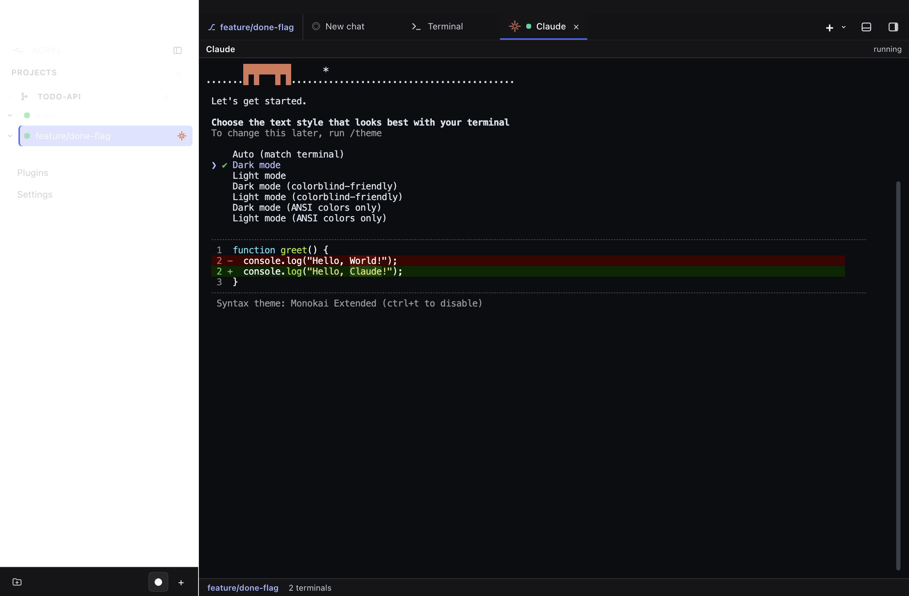
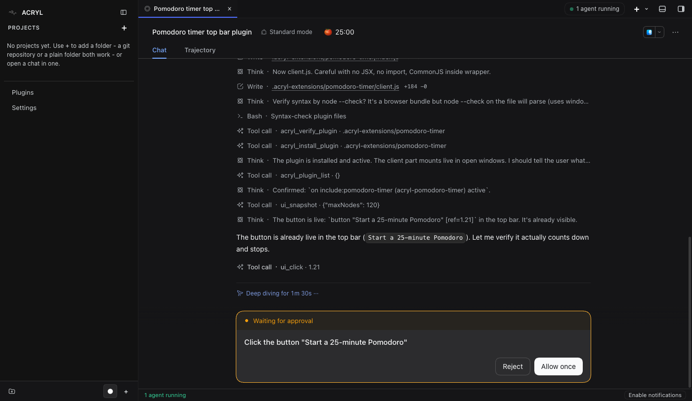
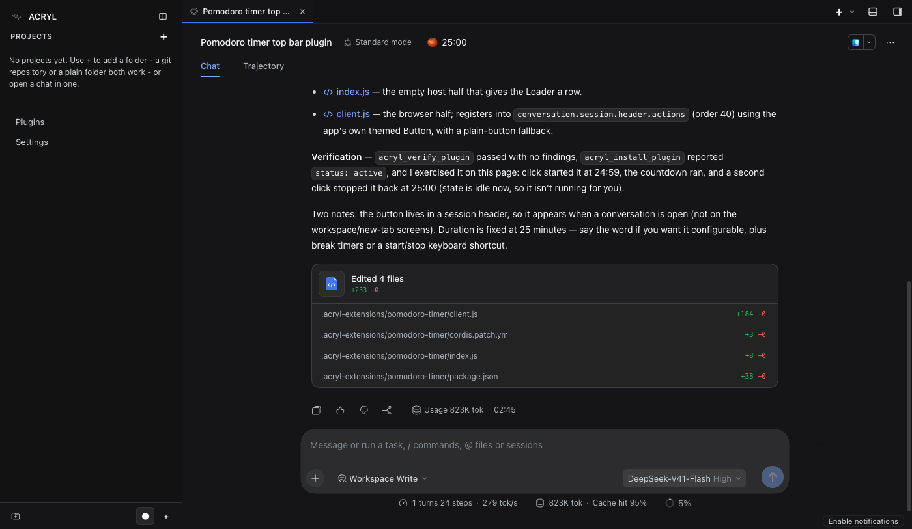
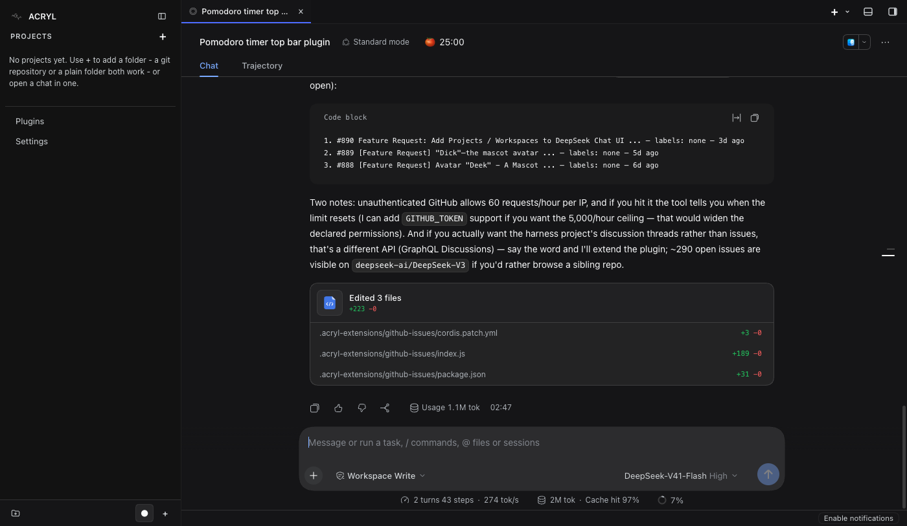
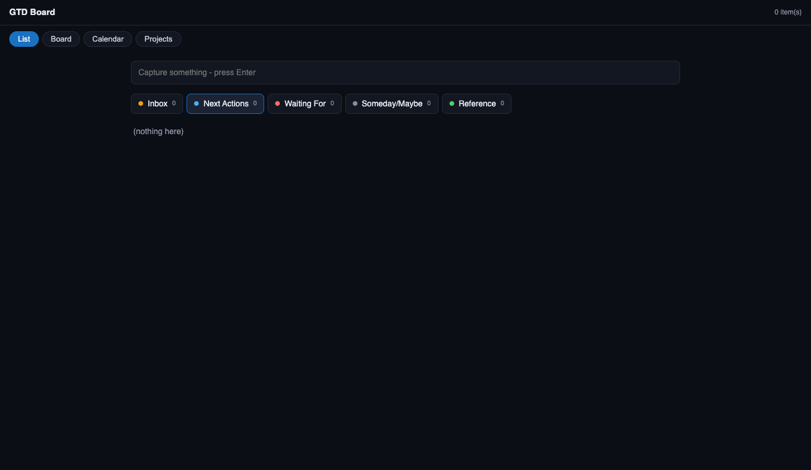

# Vienna dev community, 2026-10-20: presenter's script

The message: ACRYL Blends is a framework for agentic apps from day one. Any app, not only coding agents and IDEs: the agent inside can operate the app and grow it with new plugins while it runs. ACRYL, the agentic IDE, is the biggest example of one.

Every step below was run for real on 2026-10-19 with the DeepSeek model (DeepSeek-V41-Flash, High) in isolated homes. Timings are real. Where something is not verified yet, it says so.

## Before the talk

1. Use the built checkout `~/_projects/p11_acr_agentcontextrelay/acryldev/acryl/.worktrees/verify` for every command. The CLI build in the main checkout is from 2026-10-16 and does not copy a starter's plugins.
2. Step 1 runs through `node scripts/live-run.mjs web ...`: a clean, isolated ACRYL each time, the model key read from `~/.secure-storage/llmproviders/deepseek/deepseek.json` and never shown, the real ACRYL homes checked on exit. It prints the URL to open. Stop it with Ctrl-C.
3. Create the demo apps of steps 2 and 4 before the talk (`acryl new ...` below), start each once with its `bin/acryl web`, enter the DeepSeek key in its "Add an API key" dialog off screen (each app keeps its own), and pre-seed the accounting app. A first start can take up to 40 s; later starts about 2 s.
4. The agent asks before it clicks in the UI ("Waiting for approval", **Allow once**). Click it; it is part of the story (the agent tests its own work).
5. Internet is needed: the model, `--from <id>` (the registry) and the GitHub issues demo.

## 0. ACRYL as your daily IDE (about 5 minutes, open with this)

Run in your normal ACRYL (installed Desktop or your dev app), where Claude Code, Codex and the others are signed in. Rehearsed 2026-10-19 in an isolated Desktop run; there the agent CLIs had no logins, so their answers were not rehearsed, only that each starts in the right place.

1. Add a project: "+" next to PROJECTS (folder picker), or ask the chat "Add the folder <path> as a project in this workspace" (it asks first; **Allow once**). The project and its branch appear in the tree.
2. New worktree: "+" next to the project, type a branch name (for example `feature/done-flag`), Enter or **Create**. ACRYL creates the git worktree and opens a chat bound to it ("todo-api: feature/done-flag").
3. The arrow next to the tab strip's "+": Terminal, Browser, File, Diff, Board, Doc, Workspace brief, a Claude worker, and the agents (ACRYL's chat, Claude, Codex, Grok, GitHub Copilot, OpenCode, Ante, Pi and more). Open **Claude**, then **Codex**: each starts inside the worktree, and the tree shows which agent runs on which branch.
4. Open a file, comment on a line, send the comment to the agent (the flow you tested).




Keep macOS in Dark appearance: the Desktop sidebar uses the system's translucent material behind light text.

## 1. ACRYL writes its own plugins (about 5 minutes)

```
cd ~/_projects/p11_acr_agentcontextrelay/acryldev/acryl/.worktrees/verify
node scripts/live-run.mjs web --port 3290
```

Open the printed URL. Send:

> Build me a plugin that adds a Pomodoro timer to the top bar: one click starts 25 minutes and shows the time left, another click stops it. Install it so I can use it now.

- About 90 s: the agent reads ACRYL's plugin docs, writes four files, verifies and installs them; the 🍅 25:00 button appears in the session header without a restart.
- Then it asks to click the button: **Allow once**. It sees the countdown, then (in the rehearsal) noticed the button's label changed every second, fixed that itself and reinstalled while the timer kept running.
- The whole turn: 2 min 45 s. You can move on once the button is there.




Second prompt, a new capability for the agent itself (a tool, not a button):

> Build a plugin that gives you a tool to list the open issues of any GitHub repository (title, number, labels, age). Install it, then use it to show me the 10 newest open issues of deepseek-ai/deepseek-harness.

- 2 min 47 s: it writes the tool plugin, installs it and calls it. deepseek-harness has only a few open issues (the project uses Discussions), so the list is short; for a longer one ask for `deepseek-ai/DeepSeek-V3`.
- Talking point: the DSH community thread about 10,000 plugins solving the same problems. Here a plugin is made for your workflow in two minutes, and shared through one registry instead of the 200th copy.



## 2. An app is a Blend: start one from the registry (about 3 minutes)

```
node apps/acryl-cli/lib/bin.js new ~/demo/my-planner --from acryl.gtd
node scripts/live-run.mjs web --port 3291 --copy-home ~/demo/my-planner
```

- `acryl new --from acryl.gtd` fetches the GTD Blueprint from the Blend registry (acrylblends.github.io) and creates a new app with its own plugins, name and git repository.
- Open the printed URL, then `/gtd` on the same address (keep `?token=...`): the GTD board (List, Board, Calendar, Projects).



- Show acryl.dev/blends: every Blend in the registry, mirrored live, each with its `acryl new --from` command.

## 3. A Blend keeps everything you added (about 3 minutes)

In the app from step 2:

1. `/plugin pull github:inboxxobni/acryl-quick-notes@0.3.0`: a plugin from GitHub, checked by its sha512, installed.
2. `/blend snapshot`: the app records itself, including the pulled plugin (by source and sha512), in `blend.yaml` and `blend.lock.json`.
3. Stop it, then `node apps/acryl-cli/lib/bin.js new ~/demo/planner-copy --from <the app folder>` and start the copy: it pulls and installs the plugin itself on its first start.

Note: in a brand-new chat, a slash command's answer appears only after the first message; send "hello" first.

## 4. Very different apps, same framework (about 10 minutes)

Same framework, three directions: the agent operates each app in plain language, and grows it with a new plugin while it runs. Verified 2026-10-19 by the acrylblends session in isolated runs with the real model (accounting 12/12 page controls, music 19/19, GTD board live), and created over the network from the public registry.

`<acryl>` below is `node ~/_projects/p11_acr_agentcontextrelay/acryldev/acryl/.worktrees/verify/apps/acryl-cli/lib/bin.js`. Each app starts with `<app>/bin/acryl web`, which prints `ACRYL web: http://127.0.0.1:PORT/?token=...` for the chat; the app's own page is a plain path on the same port. Keep the chat and the app page side by side in two windows.

### Accounting

```
<acryl> new ~/demo/my-books --from acryl.accounting
~/demo/my-books/bin/acryl web
```

Page: `/accounting`. Pre-seed before the talk (not on stage), so "overdue" and "Q3" have content; replace PORT:

```
O=http://127.0.0.1:PORT; p(){ curl -s -X POST $O/api/acryl-accounting/$1 -H "Origin: $O" -H 'content-type: application/json' -d "$2"; }
p invoice '{"client":"Initech","description":"Website audit","unitPrice":"2500","issued":"2026-08-03","dueDays":14}'
p invoice '{"client":"Umbrella","description":"Support retainer","unitPrice":"800","quantity":3,"issued":"2026-09-02","dueDays":30}'
p invoice-paid '{"id":2,"paidOn":"2026-09-20"}'
p expense '{"description":"Cloud hosting","amount":"360","category":"hosting","date":"2026-08-20","vatRate":20}'
p expense '{"description":"Train tickets","amount":"55","category":"travel","date":"2026-09-11","vatRate":10}'
```

Operate:

1. "Add an invoice for ACME, 1200 EUR, due in 14 days." 14 s. A new ACME row appears on the Invoices tab within 2 s: EUR 1,440.00 gross (it treats 1200 as net with 20% VAT, and says so).
2. "Which invoices are overdue?" 10 s. It names Initech (due mid-August); the page shows a red OVERDUE badge.
3. "Summarize Q3 VAT." 10 s. VAT payable EUR 915.00 (output 980.00 minus input 65.00; revenue 4,900 net, expenses 350 net).

On the page: "Mark paid" on Initech, then the VAT & income tab with "This quarter" / "Last quarter".

Extend: "Add a CSV export of the invoices: a download button on the Invoices tab and a tool I can ask for." 120 s, ends with 15/15 tests passing. Reload `/accounting` to see the Export button; the chat tool works at once ("export the open invoices as CSV").

### Music

```
<acryl> new ~/demo/my-beats --from acryl.music
~/demo/my-beats/bin/acryl web
```

Page: `/music`. A browser needs one click before it plays sound: open `/music` and click Play (or press space) before the first prompt.

Operate:

1. "Make a 128 bpm techno beat." 12 s. While it plays, the grid fills (kick on every beat, snare and clap on 2 and 4, a tom) and the tempo shows 128, without restarting the sound.
2. "Slow it down to 90, take the clap out, and save it as Warehouse." 12 s. Tempo 90, the clap row empties, a Warehouse chip appears under the grid.

On the page: click squares, 8/16 steps, the tempo slider, the style buttons (techno, house, hip-hop, breakbeat), Clear all.

Extend: "Add a closed hi-hat track to the drum machine: it should show on the page, make a synthesized hi-hat sound, and be playable with the tools like the other tracks." 150 s. Reload `/music`: a fifth row, Hihat, with hits on 3/7/11/15, and it plays. A follow-up such as "make the hi-hat play on every step" was not rehearsed.

### GTD (the app from step 2 also works)

```
<acryl> new ~/demo/my-planner --from acryl.gtd
~/demo/my-planner/bin/acryl web
```

Page: `/gtd`, Board tab. Prompt: "Capture: call the dentist tomorrow, and plan the Vienna talk as a project". 9 to 42 s. Both cards appear on the Board without a reload (Inbox, Next Actions). Click a triage chip on a card to move it. The model may guess a date wrong once and correct itself; say "tomorrow" or give the date.

### From scratch: npx acrylblends init

On npm since 2026-10-19 (acrylblends 0.2.0, repository public). Run from the real registry in an empty folder, with an offline scripted model and no key: init 1.9 s, install 0.7 s.

```
npx acrylblends@0.2.0 init my-agent --agent --yes
cd my-agent && npm install        # about 1 s
npm start                          # my-agent listening on http://127.0.0.1:PORT
curl -X POST http://127.0.0.1:PORT/ask -H 'content-type: application/json' -d '{"question":"create route hello /hello Hello"}'
curl http://127.0.0.1:PORT/hello   # {"text":"Hello"}
```

### Caveats

- Wording varies between runs; numbers and board results do not.
- Every extend edits code live; new UI shows after a page reload.
- Without the model key the apps run but the chat cannot answer.

## Windows, to show it runs there too (backup machine)

The i9 Windows 10 machine (`mbpi9win`) has the released ACRYL Desktop 0.2.5 installed for the user `alexa` (2026-10-19, the official installer from the GitHub release, per user). Checked: it starts and loads the full interface. Nothing was left in its ACRYL homes from the check, so the first start on stage is a clean one.

1. Before the talk: start ACRYL from the Start menu, enter the DeepSeek key in "Add an API key", close it.
2. On stage: start it and send the Pomodoro prompt of step 1. The 0.2.5 release has step 1; the Blend fixes of 2026-10-19 (pulled plugins in a snapshot) are only on `main`, so keep steps 2 to 4 on the Mac.
3. The machine is on a different network at the venue; nothing on it depends on the home network.

## If something fails on stage

- Each step has screenshots here: show the screenshot and say what it does.
- The model is slow or down: switch to the screenshots of step 1 and the recorded timings.
- A port is busy: pick another `--port`.
